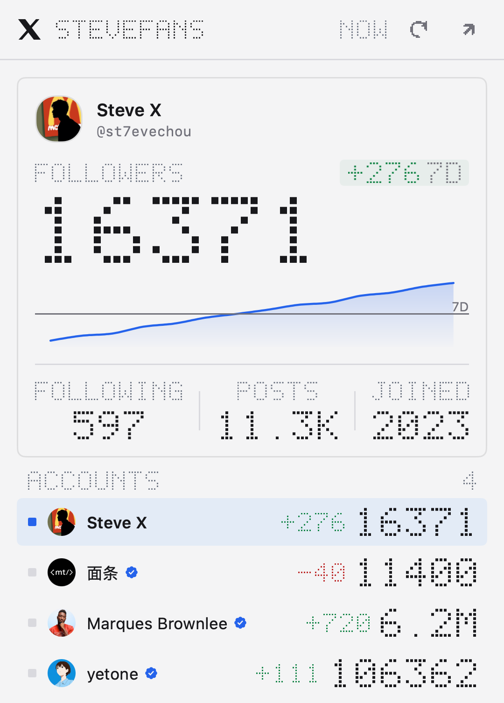
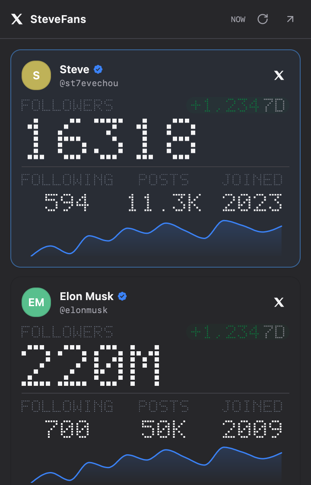

# SteveFans · X 粉丝点阵看板

一个 [Metrix.Bar](https://metrix.bar) 菜单栏看板：5×7 点阵读数、单行账号列表、7 天涨跌和 14 天面积趋势图。

`.bar` v0 单文件看板，无构建步骤、无后端、无鉴权。


[](https://github.com/zxfccmm4/stevefans-bar/releases/latest)

---

## 预览

截图里的账号是真实的，趋势和涨跌用的是样本数据。实际使用时，面积图需要开板后逐日积累两天以上采样才会出现，之前显示虚线空态。

| 浅色 | 深色 |
| :---: | :---: |
|  |  |

---

## 功能

- **主读数 + 账号列表**：面板上方是一张主读数卡，显示当前选中账号的头像、昵称、认证徽章、点阵粉丝数（悬停可看精确值）、7 天涨跌、14 天面积图，以及 FOLLOWING / POSTS / JOINED。填写多个账号时，下方按行列出每个账号的粉丝数和涨跌。
- **切换选中账号**：点一行把该账号换到主读数，双击在 X 打开；选择写入 `localStorage`，下次打开保持不变。菜单栏始终显示第一个账号的粉丝数。
- **点阵数据层**：标题、粉丝数、FOLLOWERS / FOLLOWING / POSTS / JOINED、涨跌、更新时间和错误标签都用 5×7 点阵绘制；昵称、`@handle` 和中文提示保留原生字体。
- **点阵图标**：刷新和外链图标由 lucide 轮廓光栅化成 14×14 网格，纯色方格；表头的 X 品牌标志保留官方矢量图形（18 DIP），是界面上唯一不点阵的元素。
- **数字滚动动画**：粉丝数首次加载和数值变化时用 650ms 缓出滚动到新值。
- **趋势图**：14 天原生面积图，可悬停查看每天的数值；横线标出 7 天涨跌的起算点。采样不足两天时显示虚线空态“从今天开始采样”。
- **X 认证徽章**：认证账号使用官方 X 蓝色认证徽章。
- **深浅色自适应**：跟随系统语义 token，卡片边框按外观使用 `#00000018` / `#ffffff22` 的 1px alpha 描边；涨跌色、标签色各自有浅色和深色两档。
- **面板高度自适应**：1 个账号 331 DIP，4 个 502 DIP，5 个 538 DIP；上限 560 DIP，再多就开始滚动。
- **刷新策略**：静态 10 分钟轮询；打开面板且数据超过 2 分钟时补刷；`Cmd+R` 手动刷新。
- **错误分层**：单个账号失败只影响它在列表里的那一行，选中它时主读数显示原因和 RETRY；部分失败显示顶部提示条；全部失败显示问题页并把原因写入 `tray.error`。

## 安装

1. 从 [最新 Release](https://github.com/zxfccmm4/stevefans-bar/releases/latest) 下载 `stevefans.bar`，或直接用仓库里的 [`stevefans.bar`](./stevefans.bar)，两者内容一致。
2. 用 Metrix.Bar 打开它（或在看板目录里双击）。

也可以用本地 API 安装：

```sh
export MB=http://127.0.0.1:6387
export TOKEN=...   # Metrix.Bar → Agent → Copy Prompt 里的 token

curl -fsS -X POST "$MB/v0/dashboards" \
  -H "Authorization: Bearer $TOKEN" \
  -H "Content-Type: text/plain" \
  --data-binary @stevefans.bar
```

## 配置

| 输入 | 类型 | 默认值 | 说明 |
| :--- | :--- | :--- | :--- |
| `users` | `string` | `st7evechou` | 一个或多个 X 用户名，逗号或空格分隔，不带 `@`。重复项会自动去重，第一个账号决定菜单栏数字。 |

## 数据来源

- 账号数据：`https://api.fxtwitter.com/<handle>`（公开接口，无需鉴权）。
- 头像：`https://unavatar.io/x/<handle>`，取回后转成 data URI 并按 12 小时缓存（`pbs.twimg.com` 在部分代理/TUN 环境下不可达）；网络失败时沿用旧缓存。
- 趋势：仅保存在本机 `localStorage`，每天一条、保留 31 天，键名 `fans:<handle>`；不上传、不跟随 `.bar` 导出，首次打开看板后才开始积累。

> 只有你填写的 handle 会发给 FxTwitter 和 unavatar；看板不包含任何 API key 或 token。

## 权限

```xml
<permissions>
  <network origin="https://api.fxtwitter.com" />
  <network origin="https://unavatar.io" />
</permissions>
```

`<script apis="localStorage shell match-media">`：本地趋势与头像缓存、打开 X 链接、跟随系统深浅色。

## 外观

- 面板跟随即时系统外观：浅色白底黑字，深色黑底白字。
- 表头：18 DIP 的 X 标志、2× 点阵标题、点阵更新时间，右侧是刷新和在 X 打开（打开的是当前选中的账号）。
- 卡片：surface 底色、6 DIP 圆角、1px alpha 描边，不加阴影；读数之间用 1 DIP Divider 分隔。
- 点阵比例：标题 2×、主读数 7×（5 DIP 方格 + 2 DIP 缝隙）、标签 2×、统计值 3×、涨跌与 ERROR/RETRY 2.25×。
- 主读数在 6 位数字以内保持原尺寸（最宽 243 DIP，卡片内容区 312 DIP），超过 6 位改用 `M` 紧凑写法。
- 账号列表固定 34 DIP 行高，粉丝数 6 位以内显示精确值，更长的显示紧凑写法，保证昵称不被挤没。
- 趋势图高度 48 DIP，不显示坐标轴和网格，只保留 accent 面积与 1.5 DIP 线，外加一条 7D 起算横线；没有数据时显示同高的虚线框。
- 图标按钮 26 DIP、4 DIP 圆角，`hover` / `pressed` 用 surface 语义色。

## 变更记录

| 版本 | 变化 |
| :--- | :--- |
| 1.12.4 | 表头恢复官方矢量 X 标志（18 DIP），标题保持 2× |
| 1.12.3 | 标题从 2.5× 降到 2×；X 标志改手绘 9×9 像素画（1.12.4 已换回矢量） |
| 1.12.2 | 表头压缩，标题 3× → 2.5×，X 标志首次改为像素块 |
| 1.12.1 | 由「每账号一张卡片」改为主读数 + 单行账号列表；刷新/外链图标点阵化；趋势图只画 14 天并标出 7D 起算线 |
| 1.11.1 | 旧版：每个账号一张圆角卡片 |

## 开发与校验

看板是单文件，修改后可直接用 Metrix.Bar 本地 API 校验：

```sh
# 语法/结构
curl -fsS -X POST "$MB/v0/validate" \
  -H "Authorization: Bearer $TOKEN" -H "Content-Type: text/plain" \
  --data-binary @stevefans.bar

# 隔离运行时 + UI 树（会执行一次真实网络请求）
jq -n --rawfile source stevefans.bar '{source:$source,tree:true,scheduled:true}' \
  | curl -fsS -X POST "$MB/v0/check" \
      -H "Authorization: Bearer $TOKEN" -H "Content-Type: application/json" \
      --data-binary @- 
```

替换已安装版本时使用 `GET /v0/dashboards/{id}/source` 返回的 `ETag` 作为 `If-Match`。

隔离检查用的是临时存储，且不推进定时器，所以面积图和涨跌不会出现、粉丝数停在滚动动画起始帧；要看这些部分得用一个注入过历史、跳过动画的副本（`POST /v0/check` 的 `screenshot` 参数可以直接出图）。

## 兼容性

- 在 Metrix.Bar **0.1.2**（protocol 0，macOS）上开发并验证。
- 面板与侧边栏跨平台可用；菜单栏标题/图标为 macOS 行为，Windows/Linux 的托盘展示取决于系统。

## License

[MIT](./LICENSE)

---

## English

A [Metrix.Bar](https://metrix.bar) dashboard for X follower counts: a 5×7 dot-matrix readout for the selected account, a one-line-per-account list, a 7-day delta and a 14-day area chart.

The accounts in these screenshots are real; the trend and deltas are sample data. In normal use the chart needs two daily samples before it appears, showing a dashed placeholder until then.

- **Readout + list** — the card on top shows the selected account's avatar, name, badge, dot-matrix follower count (hover for the exact figure), 7-day delta, 14-day chart and FOLLOWING / POSTS / JOINED. Every tracked account gets one 34 DIP row with its count and delta.
- **Switching accounts** — click a row to move it into the readout, double-click to open it on X; the choice persists in `localStorage`. The menu bar always shows the first account.
- **Dot matrix** — title, follower count, labels, stats, delta, freshness and error tags share one 5×7 font; names, handles and Chinese hints stay native.
- **Pixel icons** — the refresh and external-link glyphs are the lucide paths rasterised onto a 14×14 pixel grid; the X brand mark stays the official vector at 18 DIP and is the only non-pixel element in the header.
- **Rolling numbers** — the count animates over 650ms with an ease-out curve on first load and whenever it changes.
- **Trend** — a 14-day native area chart with hover values and a rule marking the 7-day baseline; before two samples it shows a dashed empty state.
- **Theme aware** — semantic tokens plus `#00000018` / `#ffffff22` hairline borders, with separate ink for deltas and labels in each appearance.
- **Panel height** — 331 DIP for one account, 502 DIP for four and 538 DIP for five; beyond 560 DIP the list starts scrolling.
- **Refresh** — every 10 minutes, plus a catch-up refresh when the panel opens after 2 minutes; `Cmd+R` for manual refresh.
- **Errors** — a failing account only marks its own row (and shows a RETRY in the readout when selected); partial failures get a banner, total failure gets a problem page and `tray.error`.

Data comes from the public `https://api.fxtwitter.com/<handle>` endpoint; avatars from `unavatar.io` (cached for 12 hours as data URIs). No keys or tokens are embedded. Install by downloading `stevefans.bar` from the [latest release](https://github.com/zxfccmm4/stevefans-bar/releases/latest) and opening it with Metrix.Bar, or POST it to `/v0/dashboards` as shown above.

## Changelog

| Version | Change |
| :--- | :--- |
| 1.12.4 | Restored the official vector X mark at 18 DIP; title stays at 2× |
| 1.12.3 | Title 2.5× → 2×; X mark redrawn as a 9×9 pixel drawing (reverted in 1.12.4) |
| 1.12.2 | Compact header; title 3× → 2.5×; first pixel version of the X mark |
| 1.12.1 | Per-account cards replaced by one readout plus a one-line account list; rasterised header icons; chart shows 14 days with a 7-day baseline rule |
| 1.11.1 | Previous layout: one rounded card per account |
